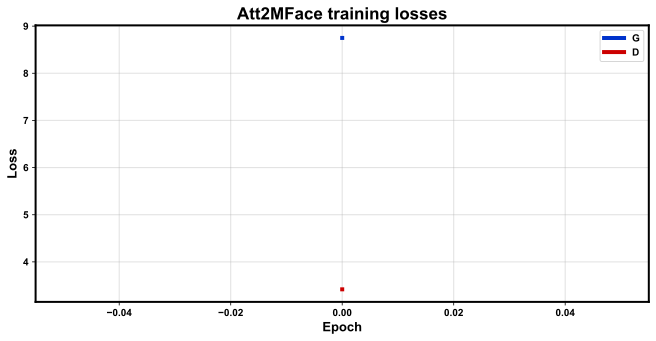

# Att2MFace — Results

Paper: Di & Patel, TBIOM 2021 (attribute → multimodal face synthesis).

## Training

| Metric | Value |
|--------|------:|
| Protocol | full |
| Epoch | 19 |
| G loss | 110.9309 |
| D loss | 21.3219 |
| Image size | 64 |
| Attr dim | 12 |

## Test (CelebA)

| Metric | Value |
|--------|------:|
| Attr L2 | 0.2823 |
| FID proxy | 0.006 |
| N | 2000 |

Real CelebA faces only; sketch modality from pencil-sketch of RGB (see DEVIATIONS.md).
